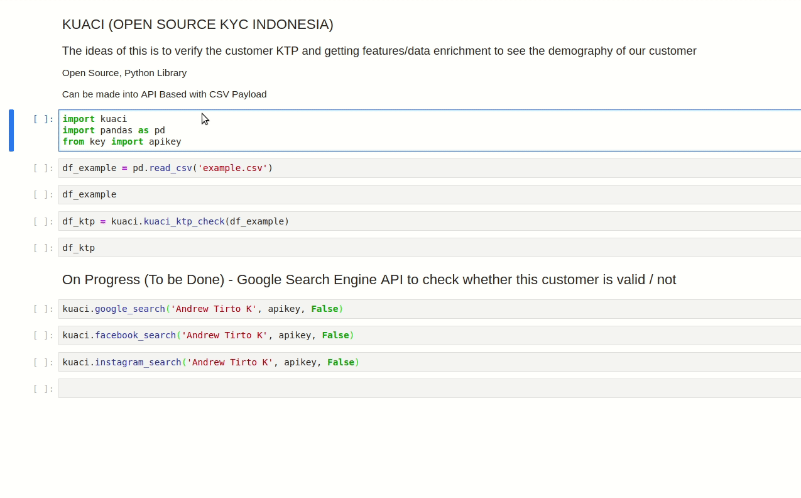

# kuaci



Open Source KTP Checker + KYC Indonesia

Validate Indonesian KTP (NIK) numbers and extract demographic information:
- **Location** — province, city/district, subdistrict from area code
- **Gender** — extracted from KTP digits
- **Date of birth** — extracted from KTP digits

Uses `kodewilayah_2025.csv` for area code mapping.

## Usage

```python
import pandas as pd
from kuaci import kuaci_ktp_check, kuaci_ktp_check_single

# Single KTP
result = kuaci_ktp_check_single(3374081105960004)

# Batch from DataFrame
df = pd.read_csv('example.csv')
result = kuaci_ktp_check(df)
```

## Requirements

```
pip install -r requirements.txt
```

See [requirements.txt](requirements.txt).

## Deprecated

Social media search functions (Google, Facebook, Instagram) have been moved to `deprecated/search.py`.
